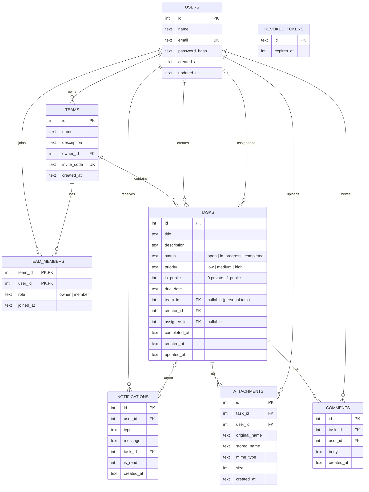

# TaskMaster – Collaborative Task Tracking Backend

A RESTful backend for team task management built with **Node.js, Express and SQLite**. Users can register, create teams, create and assign tasks, filter/sort/search them, and collaborate via comments and file attachments. Includes real-time notifications (Server-Sent Events) and generative-AI task descriptions.

## Features

| Area | What's implemented |
|------|--------------------|
| Auth | Registration, login, **JWT** sessions, **bcrypt** hashing (cost 12), real **logout** (token revocation), rate-limited credential endpoints |
| Profile | View/update profile, change password |
| Tasks | CRUD, title/description/due date/priority/status, mark complete, **filter** (status, priority, team, assignee, due range), **search** (title + description), **sort**, **pagination** |
| Teams | Create team, join via **invite code**, owner adds members by email, leave/remove, role-based permissions |
| Collaboration | Admin/creator assigns tasks to team members, comments (closed once a task is completed), **public tasks** open to comments from anyone, file attachments (upload/download/delete) |
| Notifications (optional) | Persisted notifications + **real-time push via SSE** on assignment, updates, comments, attachments, team invites |
| Generative AI (optional) | `POST /api/ai/task-description` generates title/description/checklist from a short prompt; `POST /api/tasks/:id/ai-summary` summarises a task and its discussion. Works with **OpenRouter (free models), Cohere (free trial key) or Anthropic**; with no key it uses a deterministic template fallback |
| Quality | Zod validation, centralized error handling, Helmet, CORS, Swagger UI docs, integration test suite (14 tests) |

## Quick start

Requires **Node.js 18+**.

```bash
npm install
cp .env.example .env        # set JWT_SECRET (required in production)
npm start                   # http://localhost:3000
npm test                    # run the integration tests
```

The SQLite database file is created automatically at `./data/taskmaster.db`; no separate DB server is needed.

## Try the API interactively

After `npm start`:

| URL | What it is |
|-----|------------|
| http://localhost:3000/api-docs | **Swagger UI** - every endpoint with schemas and examples; click *Try it out* |
| http://localhost:3000/api-docs.json | Raw OpenAPI 3 spec (import into Postman/Insomnia) |
| http://localhost:3000/demo | Small page showing **live SSE notifications** and the AI generator |

**Walkthrough in Swagger (about 3 minutes):**
1. `POST /auth/register` as Alice -> copy the `token` -> click **Authorize** (top right) -> paste it.
2. `POST /teams` -> note the `invite_code` in the response.
3. Open a second browser/incognito window, register Bob, **Authorize** with Bob's token, and `POST /teams/join` with the invite code.
4. As Alice, `POST /tasks` with `teamId` and `assigneeId` = Bob's id.
5. As Bob, `GET /tasks?assignee=me` -> the task appears. Then comment (`POST /tasks/{id}/comments`), upload a file, and `POST /tasks/{id}/complete`.
6. To see real-time push: log in as Bob on `/demo`, click **Connect to stream**, then repeat step 4 as Alice - the notification shows up instantly.

## Project structure

```
src/
  server.js            # entry point (listen + graceful shutdown)
  app.js               # Express app wiring (middleware + routes)
  config.js            # env-based configuration
  openapi.js           # OpenAPI spec served by Swagger UI
public/demo.html       # live notifications / AI demo page
  db.js                # SQLite connection + schema
  middleware/          # auth (JWT), validate (zod), error handling
  routes/              # auth, users, teams, tasks (+comments, attachments), notifications, ai
  services/            # access (authorization helpers), notifications (SSE hub), ai
  utils/               # AppError + asyncHandler
tests/api.test.js      # end-to-end API tests (in-memory DB)
```

## Database & schema design

**Database:** [SQLite](https://www.sqlite.org/) (embedded relational SQL database) accessed through `better-sqlite3`. The file is created automatically at `./data/taskmaster.db` (configurable via `DB_PATH`), and the schema is created on startup in `src/db.js`, so there is nothing to install or migrate. Foreign keys are enforced (`PRAGMA foreign_keys = ON`) and WAL mode is enabled for better read/write concurrency.

**Why SQLite?** The data is relational (users, teams, memberships, tasks), so SQL with foreign keys, constraints and joins is a natural fit. SQLite keeps setup to zero for reviewers. Because queries are plain SQL, moving to PostgreSQL/MySQL later only means changing `db.js` and the call sites.

### ER diagram



### Tables

| Table | Purpose | Key constraints / notes |
|-------|---------|-------------------------|
| `users` | Accounts | `email` UNIQUE (case-insensitive); only a bcrypt `password_hash` is stored, never the password |
| `teams` | Teams/projects | `owner_id` -> users; `invite_code` UNIQUE, used to join |
| `team_members` | Many-to-many users <-> teams | Composite PK `(team_id, user_id)`; `role` CHECK in (`owner`, `member`) |
| `tasks` | Core entity | `status` and `priority` enforced with CHECK constraints; `is_public` makes a task readable/commentable by everyone; `team_id` NULL = personal task; `assignee_id` NULL = unassigned (set to NULL if that user is deleted) |
| `comments` | Discussion on a task | Deleted automatically with the task (`ON DELETE CASCADE`) |
| `attachments` | File metadata | File bytes live on disk under a random `stored_name`; the DB keeps the original name, MIME type and size |
| `notifications` | Persisted notification feed | `is_read` flag; also pushed live over SSE |
| `revoked_tokens` | Logout support | Stores the `jti` of logged-out JWTs until they expire |

### Indexes

| Index | Speeds up |
|-------|-----------|
| `users.email` (UNIQUE) | Login and duplicate-email checks |
| `idx_tasks_assignee (assignee_id, status)` | "My tasks" and status filtering |
| `idx_tasks_team (team_id)` | Listing a team's tasks |
| `idx_tasks_creator (creator_id)` | Tasks I created |
| `idx_tasks_public (is_public)` | Public task feed |
| `idx_comments_task`, `idx_attachments_task` | Loading a task's comments/files |
| `idx_notifications_user (user_id, is_read)` | Unread counts and feed |

### Referential integrity

- Deleting a **team** cascades to its members and tasks; deleting a **task** cascades to its comments, attachments and notifications.
- Deleting a **user** cascades to their memberships, comments and notifications; tasks assigned to them become unassigned.
- All SQL uses parameterised statements, and sort columns are whitelisted, so there is no SQL injection surface.

## Authorization rules

- A task is visible to its **creator, assignee, and members of its team**; anyone else gets `404` (existence isn't leaked).
- **Public tasks** (`isPublic: true`) can be **read and commented on by any logged-in user** (e.g. someone with a question about the task), but only the creator/team members can edit, assign or delete them. Browse them with `GET /tasks?scope=public`.
- **Assigning:** the assignee must belong to the task's team. The **team owner (admin) and the task creator can assign to anyone in the team**; other members can only claim a task for themselves or release it. A *personal* task (created without `teamId`) can only be assigned to yourself - move it into a team first with `PATCH /tasks/{id}` `{ "teamId": 1 }`, then assign it.
- **Completed tasks are closed for comments** (`409`). Reopen the task (`status: "open"` or `"in_progress"`) to allow comments again.
- Only the **task creator or team owner** can delete a task. Only a comment's author can delete it.
- Only the **team owner** can add/remove members or delete the team; members can leave. Invite codes are visible only to the owner.

## API reference

All endpoints are prefixed with `/api`. Authenticated endpoints need `Authorization: Bearer <token>`. Errors use the shape `{ "error": { "message": "...", "details": [...] } }`.

### Auth & profile
| Method | Path | Description |
|--------|------|-------------|
| POST | `/auth/register` | `{ name, email, password }` → `201 { user, token }` (password ≥ 8 chars, letter + number) |
| POST | `/auth/login` | `{ email, password }` → `{ user, token }` |
| POST | `/auth/logout` | Revokes the current token |
| GET | `/users/me` | View profile |
| PATCH | `/users/me` | Update `name` / `email` |
| PUT | `/users/me/password` | `{ currentPassword, newPassword }` |

### Teams
| Method | Path | Description |
|--------|------|-------------|
| POST | `/teams` | Create a team (you become owner) |
| GET | `/teams` | Teams you belong to |
| GET | `/teams/:id` | Team details + members |
| POST | `/teams/join` | `{ inviteCode }` |
| POST | `/teams/:id/members` | Owner adds a user: `{ email }` |
| DELETE | `/teams/:id/members/:userId` | Remove a member / leave |
| DELETE | `/teams/:id` | Delete team (owner) |

### Tasks
| Method | Path | Description |
|--------|------|-------------|
| POST | `/tasks` | `{ title, description?, dueDate?, priority?, status?, teamId?, assigneeId? }` |
| GET | `/tasks` | List with filters (below) |
| GET | `/tasks/:id` | Task details |
| PATCH | `/tasks/:id` | Update `title, description, dueDate, priority, status, isPublic`; `teamId` moves a personal task into your team |
| POST | `/tasks/:id/complete` | Mark completed |
| PATCH | `/tasks/:id/assign` | `{ assigneeId }` (`null` to unassign). Owner/creator: anyone in the team; members: themselves only |
| DELETE | `/tasks/:id` | Delete |
| POST | `/tasks/:id/ai-summary` | AI summary of task + comments |

**`GET /tasks` query params:** `status` (open\|in_progress\|completed), `priority`, `scope` (`mine`\|`public`), `teamId`, `assignee` (`me`\|`unassigned`\|userId), `createdByMe`, `dueBefore`, `dueAfter`, `q` (search title/description), `sortBy` (createdAt\|updatedAt\|dueDate\|priority\|title\|status), `order` (asc\|desc), `page`, `limit` (max 100).
"Tasks assigned to me" = `GET /tasks?assignee=me`; "open tasks" = `GET /tasks?status=open`.

### Comments & attachments
| Method | Path | Description |
|--------|------|-------------|
| POST | `/tasks/:id/comments` | `{ body }` - any logged-in user on public tasks; `409` if the task is completed |
| GET | `/tasks/:id/comments` | List comments |
| DELETE | `/tasks/:id/comments/:commentId` | Delete your own comment |
| POST | `/tasks/:id/attachments` | `multipart/form-data`, field `file` (max 5 MB by default) |
| GET | `/tasks/:id/attachments` | List attachments |
| GET | `/tasks/:id/attachments/:attachmentId/download` | Download |
| DELETE | `/tasks/:id/attachments/:attachmentId` | Delete |

### Notifications (real-time)
| Method | Path | Description |
|--------|------|-------------|
| GET | `/notifications/stream?token=<jwt>` | **SSE** stream; emits `notification` events |
| GET | `/notifications` | History (`?unread=true` to filter) + `unreadCount` |
| PATCH | `/notifications/:id/read` | Mark one read |
| POST | `/notifications/read-all` | Mark all read |

Browser example:
```js
const es = new EventSource(`/api/notifications/stream?token=${jwt}`);
es.addEventListener('notification', (e) => console.log(JSON.parse(e.data)));
```

### AI
| Method | Path | Description |
|--------|------|-------------|
| POST | `/ai/task-description` | `{ prompt }` → `{ title, description, checklist, source }` |

## Example session (curl)

```bash
# register & capture token
TOKEN=$(curl -s -X POST localhost:3000/api/auth/register -H 'Content-Type: application/json' \
  -d '{"name":"Alice","email":"alice@example.com","password":"Passw0rdX"}' | jq -r .token)

# create a team and a task
curl -s -X POST localhost:3000/api/teams -H "Authorization: Bearer $TOKEN" -H 'Content-Type: application/json' -d '{"name":"Platform"}'
curl -s -X POST localhost:3000/api/tasks -H "Authorization: Bearer $TOKEN" -H 'Content-Type: application/json' \
  -d '{"title":"Write design doc","dueDate":"2030-01-15","teamId":1,"priority":"high"}'

# search / filter
curl -s "localhost:3000/api/tasks?q=design&status=open&sortBy=dueDate&order=asc" -H "Authorization: Bearer $TOKEN"
```

## Design decisions

- **SQLite (better-sqlite3)** – zero-setup relational store with foreign keys, indexes and transactions; swapping to PostgreSQL would only touch `db.js` and query call sites.
- **Stateless JWT + revocation list** – gives scalable auth while still making logout meaningful. Expired revocations are cleaned up on logout.
- **SSE over WebSockets** – notifications are one-directional, SSE is simpler, works through proxies and auto-reconnects. A single-process in-memory hub is used; for multi-instance deployments swap it for Redis pub/sub.
- **Security** – parameterised SQL only, whitelisted sort columns, escaped `LIKE` wildcards, uploads stored under random names (original name kept as metadata and only used in `Content-Disposition`), access checks run *before* a file is written, uniform login error to prevent user enumeration.
- **AI with graceful degradation** – the feature works offline via a template, and upgrades to a real model when an API key is configured.

## Configuration

See `.env.example`: `PORT`, `JWT_SECRET`, `JWT_EXPIRES_IN`, `DB_PATH`, `UPLOAD_DIR`, `MAX_UPLOAD_MB`, `AI_PROVIDER`, `OPENROUTER_API_KEY`/`OPENROUTER_MODEL`, `COHERE_API_KEY`/`COHERE_MODEL`, `ANTHROPIC_API_KEY`/`ANTHROPIC_MODEL`.

## Enabling AI (optional, free options available)

Set **one** key in `.env` and restart:

```
OPENROUTER_API_KEY=sk-or-...     # free models: https://openrouter.ai/keys
OPENROUTER_MODEL=<model-id>:free # optional; comma-separated list is tried in order
# or
COHERE_API_KEY=...               # free trial key: https://dashboard.cohere.com/api-keys
```

The provider is auto-detected (or force it with `AI_PROVIDER=openrouter|cohere|anthropic`). Responses include `"source": "ai"` and the `provider` used; if the key is missing, rate-limited or the call fails, you get `"source": "template"` instead - the API never errors because of AI.

## Possible next steps

Refresh tokens, email invitations, task activity log, pagination on comments, Dockerfile + CI, OpenAPI docs.
